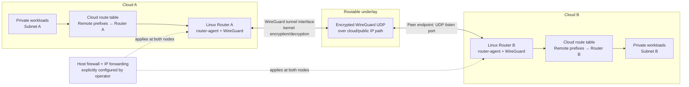
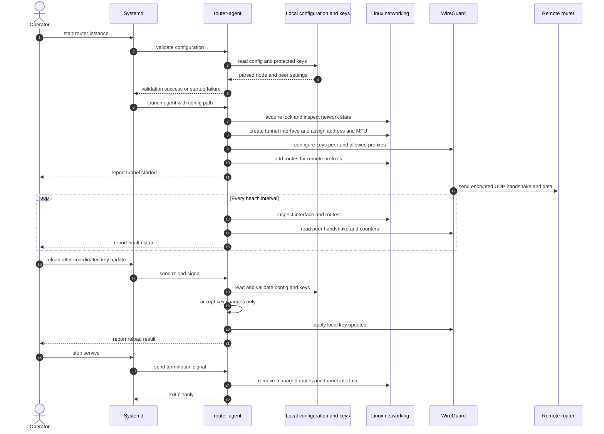

# Cross-cloud Router Design

## 1. Purpose and status

This document describes the proposed design and current implementation for
connecting private IP networks in two cloud environments through an encrypted
WireGuard tunnel.

The current scope is deliberately limited to **one Linux router node at each
end of one manually configured tunnel**. Each node is configured locally and
operated independently. The design is a foundation for a production service,
not a claim that the system is production-certified: live cloud integration,
availability, and throughput must be verified in the target environment.

## 2. Problem statement

Organizations operating workloads in multiple clouds need selected private
subnets in one cloud to communicate with private subnets in another. Setting up
and operating this connectivity can require coordinating cloud gateways,
network routes, firewall rules, address plans, encryption, and troubleshooting
across separate environments.

The resulting operational problems include:

- Establishing an encrypted path between networks with different cloud
  providers and network controls.
- Ensuring only intended private prefixes are routed through that path.
- Keeping the tunnel endpoint reachable through the ordinary underlay rather
  than accidentally routing it into the tunnel itself.
- Understanding whether failures are caused by the tunnel, host routing,
  cloud routes, security policy, or the remote workload.
- Managing keys and restarts without inadvertently exposing private key
  material or disturbing unrelated host routes.

## 3. Proposed solution

Deploy one Linux router VM in each cloud. Each VM runs the same small
configuration-managed agent and has:

1. A cloud-facing network interface reachable from the other router over UDP.
2. A dedicated WireGuard interface for encrypted overlay traffic.
3. Locally configured tunnel addresses, peer identity, peer endpoint, and
   remote allowed prefixes.
4. Explicit cloud route-table entries directing the remote private prefixes to
   the local router VM.
5. Explicit Linux forwarding and firewall policy permitting only the required
   transit traffic.

The agent creates and configures a WireGuard interface, installs the configured
remote routes, logs peer counters and handshake age, and periodically checks
local interface/peer/route state. WireGuard handles cryptographic packet
processing and handshake retries. The Linux kernel routes forwarded packets
between the cloud-facing interface and WireGuard.

The agent does **not** currently configure cloud route tables, firewall rules,
or IP forwarding. Operators configure and validate those separately. There is
no central service, automatic peer discovery, active/passive pair, or
active-active topology in this release.

## 4. Goals and non-goals

### Goals

- Encrypt traffic between one pair of Linux router nodes.
- Route explicitly configured remote prefixes through a dedicated WireGuard
  interface.
- Validate local configuration and protect private-key file access.
- Avoid taking over an unrelated interface or exact pre-existing destination
  route.
- Remove the owned tunnel and routes on graceful shutdown.
- Report basic local tunnel and peer state in logs and recover selected local
  failures when safe.

### Non-goals for this release

- Hosted SaaS dashboard or central control plane.
- AWS/Azure API credentials, provisioning, or cloud route-table automation.
- Automatic host firewall, security-group, NSG, or forwarding-rule changes.
- Multiple peers, mesh topology, route distribution, HA, or failover.
- Dynamic DNS endpoint refresh.
- Application-level reachability checks or remote metrics endpoint.
- XDP/eBPF datapath, custom encryption, or a guaranteed throughput target.

## 5. High-level design

### Component responsibilities

| Component | Responsibility |
|---|---|
| Private workload | Sends ordinary IP traffic to a remote private prefix. |
| Cloud route table | Sends that destination to the router VM in the same cloud. |
| Linux host routing/firewall | Forwards permitted packets between cloud NIC and the WireGuard interface. These policies are operator-managed. |
| `router-agent` | Validates local configuration, provisions the owned tunnel interface and routes, logs health, handles key reload, and cleans up on graceful stop. |
| WireGuard | Authenticates the peer and encrypts/decrypts overlay packets. |
| Cloud security controls | Permit the peer UDP endpoint traffic and only the intended transit traffic. |
| Remote router | Performs the reciprocal WireGuard and routing operation. |

### Control and data planes

The current design has a **local management path**, not a hosted control plane.
The operator edits a root-owned JSON config and key files, then starts or
reloads the systemd service. The agent talks to Linux networking and WireGuard
control interfaces to apply that configuration.

Application packets do not pass through the Go process. They are forwarded by
the Linux kernel; WireGuard provides the encrypted tunnel datapath. The agent
does not inspect application payloads.

## 6. Data-plane packet flow

1. A workload in Cloud A sends a packet to an address in Cloud B's configured
   private prefix.
2. Cloud A's route table sends the packet to Router A.
3. Router A's host forwarding and firewall policy permit the packet from the
   cloud-facing interface to the WireGuard interface.
4. The WireGuard peer's allowed-prefix routing selects the configured peer.
   The Linux route installed by the agent directs that destination to the
   configured WireGuard interface.
5. WireGuard authenticates and encrypts the packet, then sends the resulting
   UDP datagram to Router B's configured underlay IP and UDP port.
6. Cloud network controls on the path permit the UDP datagram to Router B.
7. Router B's WireGuard interface authenticates and decrypts it.
8. Router B's host forwarding/firewall and cloud route table send the original
   packet to the destination workload.
9. Return traffic follows the reciprocal route and policy on both sides.

If any cloud route, host route, forwarding setting, firewall rule, peer key,
allowed prefix, or return route is missing or inconsistent, the tunnel may
show as configured while application connectivity still fails.

## 7. Configuration and trust boundaries

Each node has a separate local config. The example schema is in
[`config.example.json`](./config.example.json).

| Field | Meaning |
|---|---|
| `interface` | Dedicated Linux WireGuard interface name managed by the agent. |
| `addresses` | Local overlay address(es) assigned to that interface. |
| `mtu` | Interface MTU. Operators must select it based on the effective underlay path MTU and validate it with real traffic. |
| `listen_port` | Local UDP port WireGuard listens on. |
| `private_key_file` | Absolute path to a root-owned private key file with restrictive permissions. |
| `peer.public_key` | Remote node's WireGuard public key. |
| `peer.endpoint` | Remote underlay IP and UDP port. The current agent requires a numeric IP. |
| `peer.allowed_ips` | Remote overlay and private prefixes routed through this peer. Default routes are rejected. |
| `peer.persistent_keepalive_seconds` | Optional periodic keepalive, commonly useful when a peer is behind stateful NAT. |
| `peer.preshared_key_file` | Optional path to a separately protected preshared key file. |

The agent rejects malformed or unknown config fields, duplicate JSON keys,
insecure key-file permissions, invalid keys, default routes, and route
recursion involving the peer endpoint. Config and key files should be installed
atomically by an operator and never committed to source control.

Trust boundaries:

- Cloud workloads are not trusted to bypass the configured cloud/host routing
  and firewall policy.
- The two router VMs authenticate one another using WireGuard public keys.
- The root account and `CAP_NET_ADMIN` are highly privileged; the systemd unit
  restricts the service to the network capability where supported.
- The cloud underlay is treated as untrusted; WireGuard encrypts tunnel
  payloads in transit.
- Cloud route tables and firewalls are outside the agent's enforcement
  boundary and must be audited separately.

## 8. Startup, health, reload, and shutdown

### Startup details

The service validates configuration before launch. The agent then acquires a
per-interface process lock, checks that any existing named interface is one it
owns, checks exact destination route conflicts, creates the tunnel interface,
assigns its addresses and MTU, configures WireGuard, and adds routes marked
with the agent's route protocol identifier.

If startup fails after interface creation, the agent attempts cleanup and
returns the original and cleanup errors. A stale owned interface is inspected
and replaced on restart; unrelated interfaces and conflicting routes are not
silently deleted.

### Health and recovery

On the configured interval the agent checks that its interface still exists,
is still the expected owned WireGuard interface, and is up. It checks for
agent-owned routes, restores a missing route only if it can do so without
conflicting with an existing route, and reads peer handshake time and byte
counters. A missing peer can be reapplied from local configuration.

Health log output is useful for operational monitoring but is not an
application-level connectivity test. An idle peer may have an old handshake
without being unhealthy. Some health errors are logged and retried; they do not
currently trigger an automatic failover or guaranteed service restart.

### Key reload

SIGHUP reloads only the local private key and optional preshared key, and only
when the tunnel topology remains identical. Interface, MTU, listen port,
endpoint, peer identity, addresses, or allowed-prefix changes are rejected
until an operator restarts the service. Coordinate reciprocal peer changes
before rotating keys; no dual-key overlap or automatic rollback is provided.

### Shutdown and crash behavior

SIGINT/SIGTERM causes the agent to remove its tracked routes and delete its
owned tunnel interface. After an unclean process or VM failure, kernel state
may remain until reboot or a later service start. The next start only recovers
an interface carrying the agent's ownership alias. Host/cloud routes and
firewall changes made by operators are not removed by the agent.

## 9. Deployment and operations

Deploy the same agent binary and a node-specific config to each Linux router.
Keep local private keys distinct. Configure the reciprocal peer and matching
allowed prefixes on the other node. Then, separately:

1. Ensure WireGuard kernel support is available before the service starts.
2. Permit the peer's UDP port in cloud security controls and host firewall.
3. Add cloud routes for remote private prefixes pointing to the local router
   VM.
4. Enable IP forwarding only when needed and apply explicit forward firewall
   rules. Do not enable forwarding globally without a policy.
5. Start and monitor the systemd service and its journal logs.
6. Test traffic in both directions, including MTU/fragmentation behavior,
   process restart, VM reboot, route conflicts, peer reachability, and key
   rotation.
7. Benchmark realistic packet sizes, concurrency, loss, and latency on the
   actual VM/NIC before making a throughput commitment.

Operators should alert on sustained traffic failure using workload-level
probes or external monitoring. Agent logs alone cannot distinguish every
cloud-route, host-firewall, peer, and application failure.

## 10. Failure modes and current handling

| Failure | Current behavior | Operator action |
|---|---|---|
| Invalid config or unreadable/unsafe key file | Startup or reload rejected with an error. | Correct file contents, owner, or permissions; retry. |
| Interface name already belongs to another device | Agent refuses to take it over. | Resolve name conflict explicitly. |
| Exact destination route already exists | Startup fails before route installation. | Review route ownership and resolve conflict. |
| Peer UDP path blocked | WireGuard cannot complete a handshake; counters/handshake logs expose limited symptoms. | Check cloud ACLs, host firewalls, endpoint and return path. |
| Missing local interface or route | Health check attempts safe local recovery; failure is logged and retried. | Inspect kernel logs and route state; alert via external monitoring. |
| Peer unavailable | WireGuard retries handshakes; no automatic alternate path exists. | Restore peer/network or fail over operationally. |
| Cloud route/firewall/forwarding misconfiguration | Not managed by the agent; traffic may fail despite a configured tunnel. | Validate cloud and host policies independently. |
| Process or VM crash | Graceful cleanup may not run; stale owned interface may remain until restart/reboot. | Inspect residual routes/interface and service logs. |
| Key rotation mismatch | Peer authentication fails until both sides agree. | Coordinate both nodes and retain a tested rollback key/config. |

## 11. Security considerations

- Use WireGuard's standard cryptographic protocol; do not implement encryption
  in Go or eBPF.
- Restrict private and preshared key file access to root. Do not put secret
  values in logs, tickets, or source control.
- Restrict UDP ingress to the known peer endpoint where cloud networking
  permits it.
- Keep `peer.allowed_ips` as narrow as practical. Routes are host-wide kernel
  state and have consequences beyond the agent process.
- Use least-privilege host forwarding and cloud route/firewall policy.
- Protect the agent binary, configuration directory, runtime directory, and
  systemd unit from unprivileged modification.
- Review systemd sandbox/capability behavior on the target distribution; a
  service that cannot create/configure WireGuard must fail visibly rather than
  running in a misleading healthy state.
- Keep the Go toolchain and dependencies patched; CI verifies modules, runs
  tests/static checks, and invokes `govulncheck`.

## 12. Performance and MTU

The Go agent configures the tunnel; it is not in the packet-processing path.
WireGuard and the Linux networking stack process data packets. Throughput
depends on VM SKU, CPU, cloud NIC and offloads, kernel/WireGuard implementation,
path MTU, packet-size distribution, concurrency, and cloud network limits.

The configured MTU must account for WireGuard and outer-IP overhead. A value
that works for one IPv4 path may not work for IPv6 or a different underlay.
Validate with path-MTU and fragmentation-sensitive tests, then benchmark
bidirectional application-like traffic. There is no certified throughput
target in the current release.

## 13. Future work / production acceptance gates

These are not implemented by this design slice and require separate
implementation and validation:

- Linux VM integration tests that create a real WireGuard interface and send
  packets through two nodes.
- End-to-end probes, alerting integration, and clearer health/readiness
  contracts.
- A documented strategy for crash recovery and route ownership under service
  manager restarts.
- Active/passive redundancy or another explicitly chosen availability model.
- Automated and reversible cloud route deployment, if brought into scope.
- Tested key rotation with coordination/rollback procedures.
- Performance, loss, latency, MTU, and failure-injection results on supported
  cloud VM families.
- Release packaging, signed artifacts, upgrade/rollback procedure, and support
  matrix for Linux distributions and kernels.

Production acceptance should require successful bidirectional connectivity,
failure/restart recovery, no disruption of unrelated routes, validated
firewall boundaries, a rehearsed key rotation, and measured performance against
an agreed service objective in the target clouds.

## 14. Repository implementation references

- Agent entry point: [`cmd/router-agent/main.go`](./cmd/router-agent/main.go)
- Configuration model and validation: [`internal/config/config.go`](./internal/config/config.go)
- Linux tunnel lifecycle: [`internal/tunnel/tunnel_linux.go`](./internal/tunnel/tunnel_linux.go)
- Example node configuration: [`config.example.json`](./config.example.json)
- systemd unit template: [`deploy/systemd/crosscloud-router@.service`](./deploy/systemd/crosscloud-router@.service)
- Operator instructions and validation checklist: [`README.md`](./README.md)
